# Footfall

**Eight strangers just bought a T-shirt from a web shop. None of them exist.**

Footfall sends a crowd of synthetic shoppers into a website, each in a real Chrome browser, each
with their own eyes, hands, phone and patience. They think out loud, they get stuck where real
customers would, and they say why. The shop's own database decides who succeeded. Then you fix the
site and send the same people back.

<p align="center">
  <a href="#the-3-minute-demo">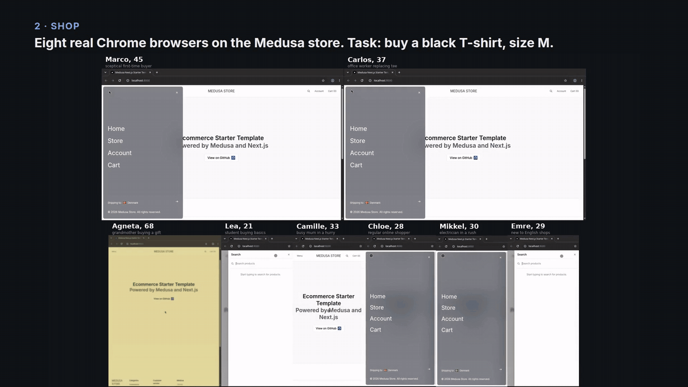</a>
</p>

<p align="center"><a href="#the-3-minute-demo"><b>▶ Watch the 3-minute demo</b></a></p>

|  |  |
| --- | --- |
| **8 / 8** | orders placed by the crowd, each one checked in the store's database |
| **6** | real usability problems found on an unmodified open-source store, none planted |
| **−53 %** | turns needed to buy the same shirt after three rounds of fixes |
| **~$3** | per crowd of eight, about eight minutes, all of them shopping at once |

Built for the Meta Global AI Developer Hackathon 2026, from October 26 to November 4, on
**Muse Spark 1.3** (each persona's mind) and **Muse Wonder 1.0** (their eye).

## The 3-minute demo

https://github.com/user-attachments/assets/4ad91bd0-105a-4272-92da-06c0dbce293c

Also on [YouTube](https://youtu.be/a8vHFX6mCUA). Every frame of it comes from the recorded runs: the wall of browsers, the replayed thoughts, the
database, the clocks.

---

## Usability tests take weeks, and the testers rarely look like your customers

A real test means recruiting people, booking them, watching recordings and writing it all up. And
the people who sign up are rarely the grandmother on her tablet or the father in a hurry on his
phone, the ones who give up and leave without telling you.

Footfall does it in minutes, with a crowd recruited from the site itself.

## 1. Meet the crowd

Muse Spark opens the site as a first visitor would, reads what the owner says about the audience,
and recruits the people who would really come: ages, jobs, cities, the device they'd use, and
impairments at the rate they occur in that audience. A developer tool gets developers. A cheap
clothing shop gets a student in Berlin, a busy mum in Lyon and, sometimes, a grandmother in
Uppsala buying a gift.

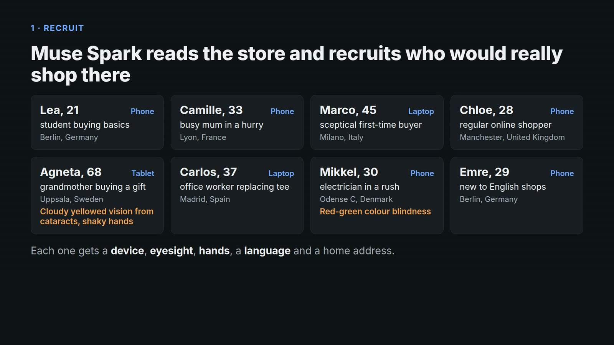

The crowd is a plain JSON file, so you can read it and edit it before anyone shops.

## 2. They see the screen their own way

The model never sees the page's code, only pixels. Before each screenshot reaches Muse Spark, it
goes through the persona's eyes: blur and a yellowed lens for cataracts, lost contrast, the
Machado (2009) colour-vision matrices for red-green blindness. Their hands are simulated too: a
tremor moves every tap before it reaches the screen. Phones and tablets are emulated with touch
and a mobile user agent.

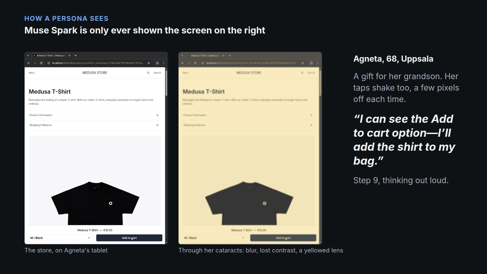

## 3. They think out loud

Each turn, Muse Spark gets the persona, the goal, their recent thoughts and one degraded
screenshot, and answers with a thought and an action: tap, type, scroll. Here is Agneta, 68, right
after the screen above. Her tap worked, but all she could see was a tiny counter changing in a
corner:

<p align="center">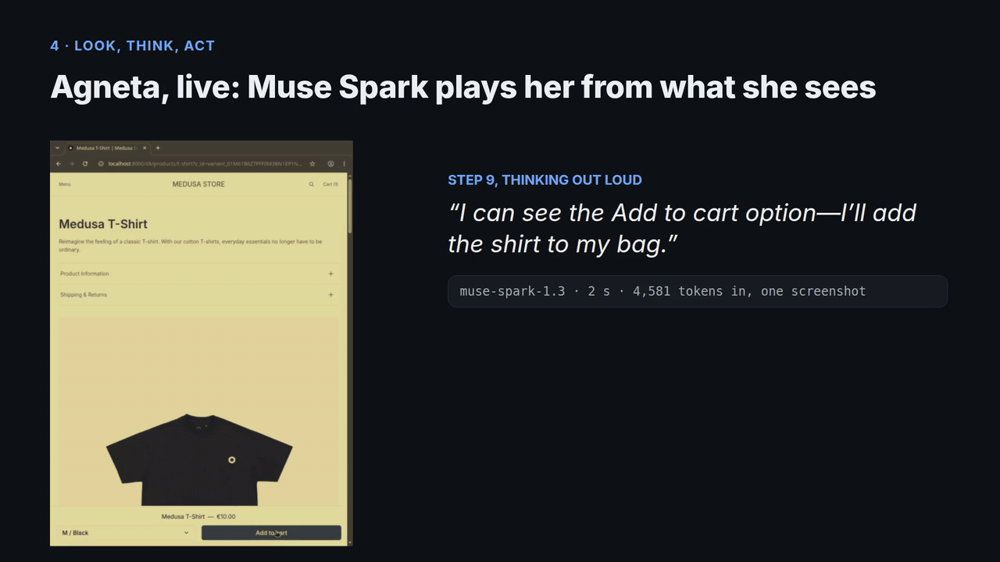</p>

She ended up with three shirts in her bag and had to fix the quantity. That became the first
problem on the list.

## 4. Muse Wonder checks where the finger lands

Spark decides *what* to tap; Muse Wonder makes sure the tap lands *there*. Before each tap, Wonder
looks at a zoomed crop of the spot, still through the persona's eyes, and corrects the aim, the
way your eye corrects your hand while you move a pointer. Without it, taps on phone screens landed
a row too high and the crowd reported its own misses as site bugs.

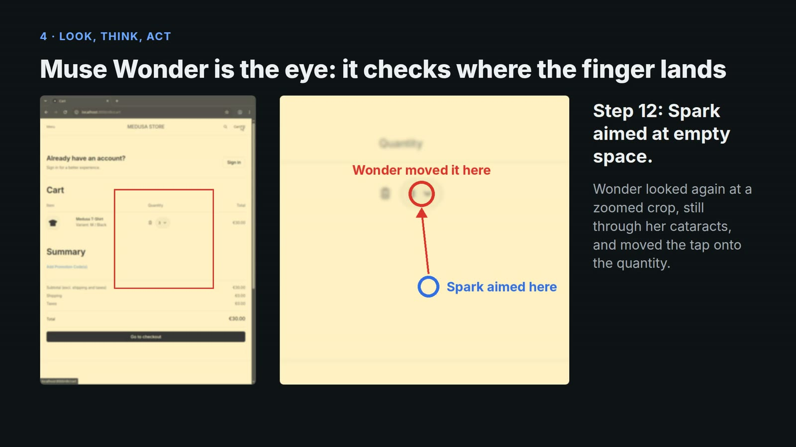

## 5. "Done" means an order in the database

No one is taken at their word, not even the model. After each session, a read-only SQL query asks
the store whether an order exists from that person's email, with the right item.

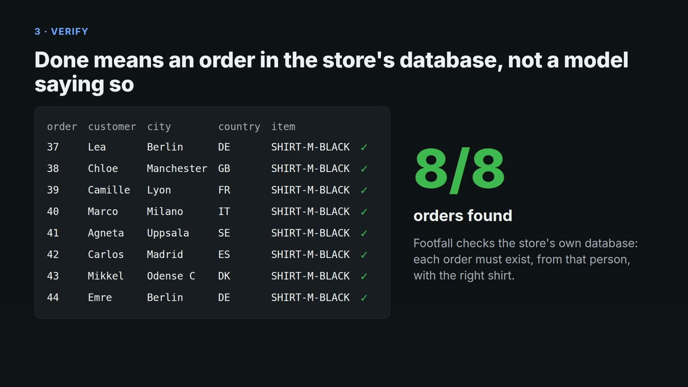

## 6. What got in their way, in their words

Muse Spark reads every journal and groups the struggles into friction points, ranked by how many
people hit them. A friction is kept only if its quotes appear word for word in the turn it cites.

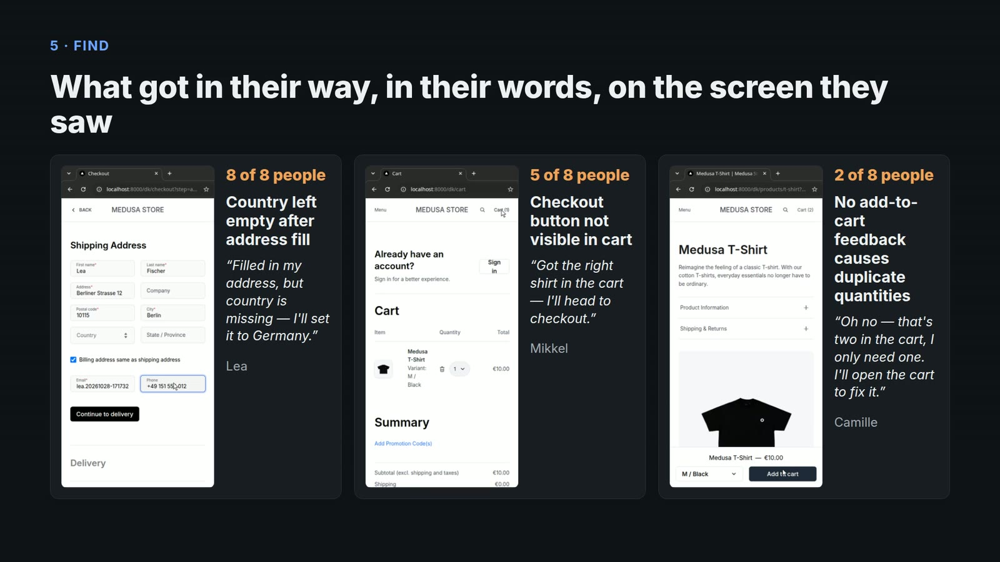

What the crowd found on the unmodified store:

| Friction | Who | What they suggested |
| --- | --- | --- |
| "Add to cart" gives no feedback but a tiny counter: Agneta tapped it again and again | 2 of 8 | instant confirmation, mini-cart, no double submit |
| Country left empty below the address fields | 7 of 8 | preselect the shop's country |
| Size preselected to XL; on phones, choosing it takes open, pick, close | 7 of 8 | no default size, inline size buttons |
| Checkout and Place order below the fold | 7 of 8 | sticky action buttons |
| Delivery cost hidden in a collapsed panel that runs off a laptop screen | Marco, the sceptic | delivery cost and time next to the button |
| Home page shows no products | Agneta | products on the home page |

## 7. Then it double-checks, on the screens

A journal says what a person felt, not why. For each friction, Muse Spark is shown the screens
before, at and after the quoted moment, and the action the person took, and decides: did the site
cause this, or did our own harness (a tap that landed a row away)? Harness faults are set aside,
not reported to the site owner.

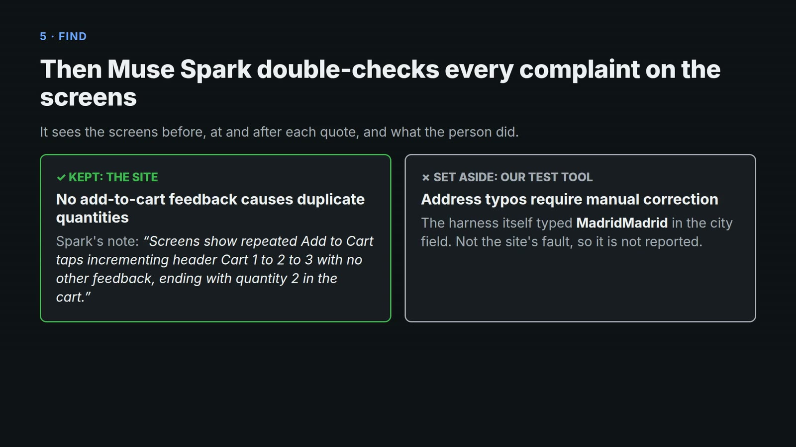

## 8. Fix the store, send the same people back

Same crowd, same task, new version of the site. The store was fixed three times
([`fixes/`](fixes) holds the patches) and the crowd came back each time:

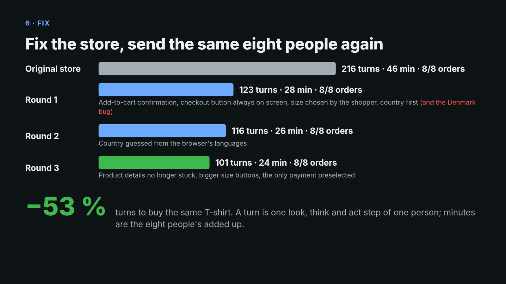

| Version | Orders | Turns, whole crowd | Minutes, whole crowd | What the crowd said next |
| --- | --- | --- | --- | --- |
| Original | 8/8 | 216 | 46 | the table above |
| Round 1: the fixes above | 8/8 | 123 | 28 | the country now defaults to **Denmark** for everyone |
| Round 2: country from the browser's languages | 8/8 | 116 | 26 | Marco's delivery panel still runs off the screen; the only payment option is not selected |
| Round 3: those two, larger size buttons | 8/8 | **101** | **24** | Standard and Express delivery cost the same, with nothing to tell them apart |

The best moment: **round 1's fix caused round 1's main problem.** Preselecting the country from
the URL put Denmark in front of a mum in Lyon. The crowd caught it on the first run back:

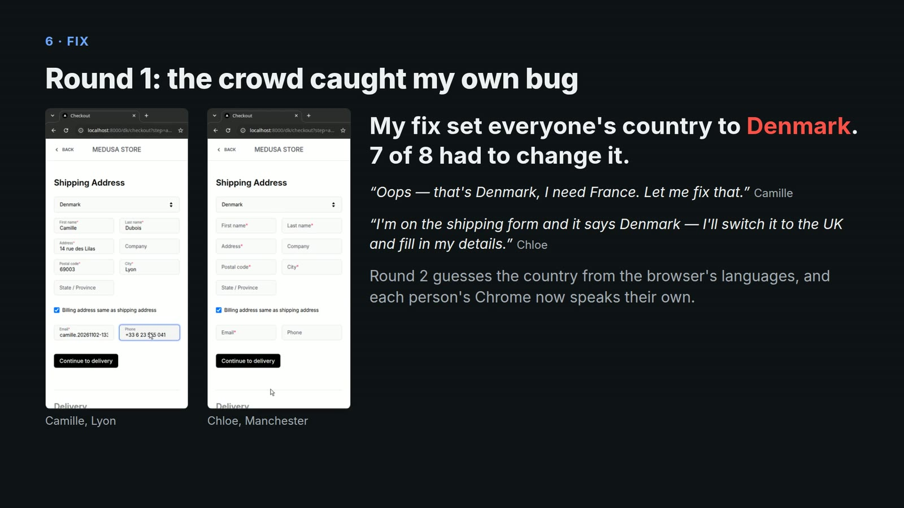

Now each persona's browser speaks the languages of the country they live in, as a browser bought
there would, and the store guesses their country the way it would for a real visitor.

The same eight people, before and after, on the same clock:

<p align="center">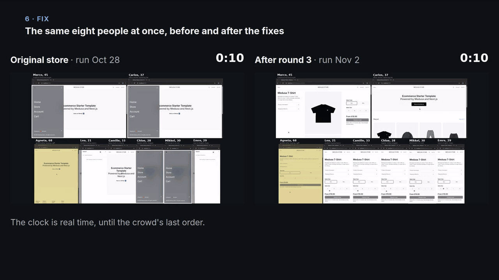</p>

## Under the hood

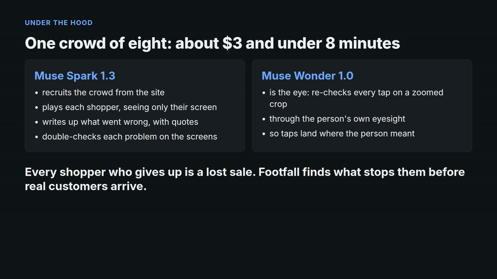

- **One private desktop per persona**: an X server (Xvfb), a throwaway Chrome profile, real mouse
  and keyboard events through XTEST. The model works from screenshots only.
- **Stateless turns**: persona, goal, the last 15 journal entries and one screenshot. A long
  session costs the same per turn as a short one, about $0.004. The journal also carries what a
  person would notice without reading: that an action changed nothing, that only a small spot
  flickered, that this is the fourth tap in the same place.
- **The funnel from the browser itself**: the URL, read over DevTools, says where each person is,
  from product page to "Thank you".
- **A budget guard on every call**: each request is priced before it is sent and refused if it
  would go over budget. 4,715 model calls over the whole hackathon, all logged.
- **Everything in one page per run**: `runs/<time>-crowd/report.html` holds the crowd, the funnel,
  each friction beside the screen as that person saw it, and the before and after.

<details>
<summary>The modules</summary>

| Module | Role |
| --- | --- |
| `footfall/recruit.py` | recruits a crowd from the site's real audience, at realistic rates |
| `footfall/session.py` | one persona's look, think, act loop, funnel tracking, ground truth |
| `footfall/senses.py` | eyesight filters on screenshots, tremor on taps |
| `footfall/personas.json` | a hand-made crowd: who they are, how they see, how their hands move |
| `footfall/browser.py` | a throwaway Chrome profile per persona, with Chrome's own bubbles off |
| `footfall/desktop.py` | private X display (Xvfb), screenshots, XTEST input |
| `footfall/store.py` | read-only SQL against the store to check an outcome |
| `footfall/insights.py` | friction points from the journals, quotes checked, then checked on the screens |
| `footfall/wall.py` | one video of every screen, each as its persona saw it, with the verdict |
| `footfall/compare.py` | the same crowd on two versions of a site, turn by turn along the funnel |
| `footfall/report.py` | one self-contained HTML page per run |
| `footfall/meta.py`, `computer.py` | Responses API client and the computer tool's action set |
| `footfall/budget.py` | prices every call before sending it and refuses anything over budget |
| `demo/build.py`, `readme.py` | the demo video and these pictures, made from the runs |

</details>

## Run it

Needs Linux, `Xvfb`, `ffmpeg`, Google Chrome and `psql`, plus a site to test with a database you
can read. The scenario in `scenarios/` targets Medusa's
[`dtc-starter`](https://github.com/medusajs/dtc-starter) (Next.js, MIT) running locally:
storefront on :8000, Postgres on :5442 (`FOOTFALL_STORE_DB` points elsewhere).

```sh
python3 -m venv .venv && .venv/bin/pip install httpx python-xlib pillow websocket-client
.venv/bin/python -m unittest discover -s tests -t .

export MODEL_API_KEY=...
# paid calls are refused unless a budget is set
export FOOTFALL_BUDGET_USD=5

# 1. recruit, then read and edit crowds/medusa-tshirt.json
.venv/bin/python -m footfall recruit scenarios/medusa-tshirt.json \
    --count 8 --audience "a small European brand selling cheap everyday basics"
# 2. shop
.venv/bin/python -m footfall crowd scenarios/medusa-tshirt.json \
    --crowd crowds/medusa-tshirt.json --parallel 4
# 3. find what got in their way
.venv/bin/python -m footfall insights runs/<time>-crowd
# 4. look at it
.venv/bin/python -m footfall wall runs/<time>-crowd
.venv/bin/python -m footfall compare runs/<before>-crowd runs/<after>-crowd
.venv/bin/python -m footfall report runs/<after>-crowd
.venv/bin/python -m footfall ledger
```

Each crowd writes `runs/<time>-crowd/`: per persona `events.jsonl`, the raw API responses, every
screenshot both raw and as seen, `screen.mp4` and `result.json`; then `crowd.json`,
`insights.json`, `wall.mp4` and `report.html`.

The demo video is built from these runs (`.venv/bin/python -m demo.build runs/footfall-demo.mp4`,
run ids at the top of the file): slides rendered by headless Chrome, one person's session replayed
with the model's thought at each step, and the walls of the original store and the fixed one side
by side. `python -m demo.readme` then cuts the pictures above out of it.

## Where it started: Apprentice

The hackathon started with `apprentice/`: Muse Spark watched a Blender tutorial video and wrote
checked steps, then Muse Spark or Muse Wonder redid them in Blender through the GUI, with a
verifier reading the scene after each step. Both finished Blender Studio's "Creating Meshes"
lesson, 6/6 steps verified. The private desktop, the budget guard and the API client Footfall runs
on came from it.

```sh
.venv/bin/python -m apprentice run tutorials/pebble --mock --record   # offline replay
```
